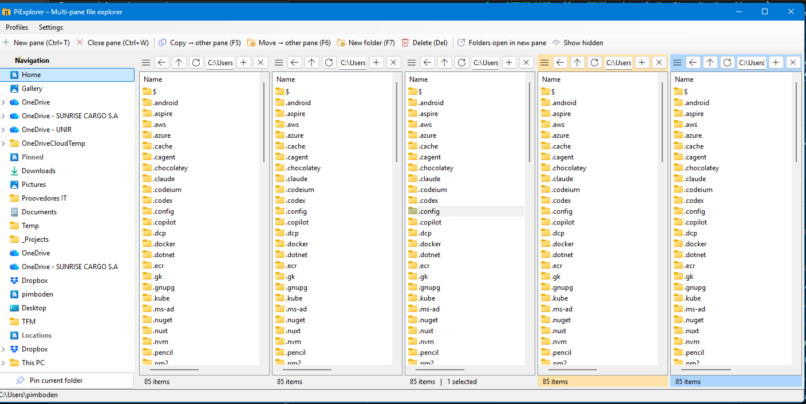
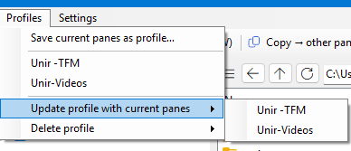
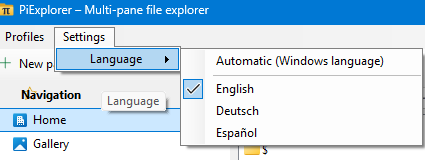
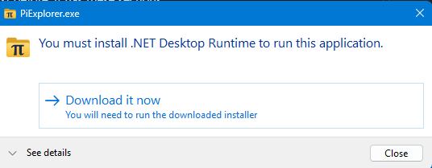

# PiExplorer

A small multi-pane file explorer for Windows. Open as many folder panes as you like side by side,
copy or move files between them, and save sets of panes as named profiles so you can bring back
the same working layout for repetitive tasks.



## Download

Get the latest `PiExplorer.exe` from the [Releases page](https://github.com/pimboden/PiExplorer/releases/latest) –
no need to clone or compile. You only need the [.NET 11 Desktop Runtime](https://dotnet.microsoft.com/download/dotnet/11.0) (x64);
if it is missing, the app tells you and offers the download.

## Features

- **Multiple panes** side by side; drag a pane's grip to reorder, duplicate a pane, close it.
- **Copy / move between panes** (F5 / F6) – files go to the pane you used before, else the neighbour.
- **Favorites / navigation panel** on the left with pinned folders, drives and libraries.
- **Profiles** (menu *Profiles*): save the currently open panes and their folders under a name,
  load them later, update a profile with the current panes, or delete it.
  Profiles are stored in `%AppData%\PiExplorer\profiles.json`.

  

- **Path bar** at the bottom showing the full path of the selected item (or the active pane's folder).
- Remembers the last session (panes, window position, options).
- Languages: English, German, Spanish (follows the Windows language by default).

  

### Shortcuts

| Key | Action |
| --- | --- |
| Ctrl+T / Ctrl+W | New pane / close pane |
| Ctrl+Tab | Switch pane |
| F5 / F6 | Copy / move to the other pane |
| F7 | New folder |
| F2 / Del | Rename / delete |
| Alt+Left / Backspace | Back / up one folder |
| Ctrl+L | Edit the path |

## Requirements

The published exe is small because it does **not** bundle .NET. It needs the
**.NET 11 Desktop Runtime** (x64). If the runtime is missing, Windows shows a dialog with a link
to download it, and the app exits.



## Build

Debug build:

```powershell
dotnet build
```

Publish the small single-file exe (framework-dependent, ~180 KB):

```powershell
dotnet publish PiExplorer.csproj -c Release -o publish
```

The result is `publish\PiExplorer.exe`.

## Release

Releases are built automatically by GitHub Actions. Push a version tag and the exe is attached to a new release:

```powershell
git tag v1.0.0
git push origin v1.0.0
```

## Simulate a missing .NET runtime

Point `DOTNET_ROOT` at an empty folder so the exe cannot find any runtime. The variable only
applies to the current PowerShell window.

```powershell
$env:DOTNET_ROOT = "$env:TEMP\no_dotnet"
New-Item -ItemType Directory -Force $env:DOTNET_ROOT | Out-Null
.\publish\PiExplorer.exe
```

The "install .NET" dialog appears instead of the app. To go back to normal:

```powershell
Remove-Item Env:DOTNET_ROOT
```
